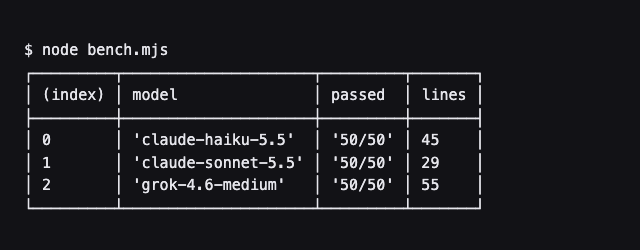

# Results: Roman numeral converter

Three models, one prompt ([PROMPT.md](PROMPT.md)), graded by `bench.mjs` on the same 50 cases.

| Model             | Tests passed | Time         | Lines | Pros                                                                                                                                              | Cons                                                                                                                                                                                 |
| ----------------- | ------------ | ------------ | ----- | ------------------------------------------------------------------------------------------------------------------------------------------------- | ------------------------------------------------------------------------------------------------------------------------------------------------------------------------------------ |
| Claude Sonnet 5.5 | 50/50        | 9.6 s        | 29    | Shortest answer. Validates by round trip (parse, convert back, compare), so one check rejects every non-standard form without listing the rules.  | Error messages don't say which input was wrong.                                                                                                                                      |
| Claude Haiku 5.5  | 50/50        | 13.9 s       | 45    | Uses the well-known canonical-form regex, and its error messages include the bad input.                                                           | Keeps a second symbol table just for parsing, and needs an extra empty-string check because the regex matches `""`.                                                                  |
| Grok 4.6 (medium) | 50/50        | not recorded | 55    | Same round-trip idea as Sonnet, with clear variable names. Builds its lookup map from the one numeral table instead of a second hand-written one. | Longest answer: a hand-written two-character parser sits in front of the round trip, which already catches everything. Error messages are just "invalid number" and "invalid roman". |

Time is how long each run took from prompt to finished file.

## What it showed

- All three models met the whole spec, including the strict cases a naive answer misses (`IIII`, `VX`, `IC`, `0`, `4000`, `NaN`). A deliberately naive answer scores 25/50 on the same grader.
- The difference was style, not correctness. Sonnet and Grok both reused `toRoman` to check `fromRoman`, and Sonnet did it in half the lines. Haiku wrote the textbook regex version with the most helpful errors.
- With only one task and one run per model, this doesn't rank the models in general.

The answers are in [solutions/](solutions/). Run `node bench.mjs` to grade them again.
